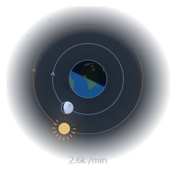
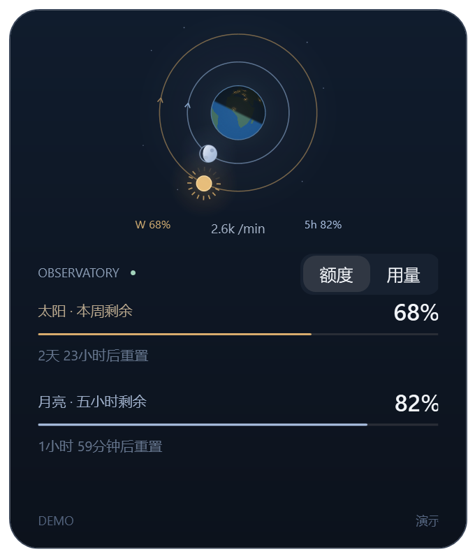
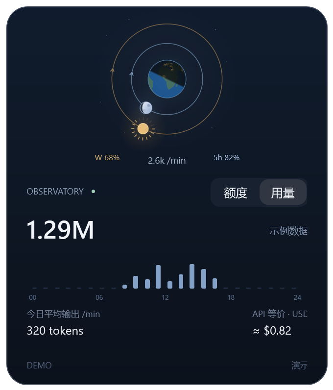

<p align="center"></p>
<h1 align="center">OrbitQuota · 星轨额度</h1>
<p align="center"><strong>用日月轨道，看见 Codex 额度。</strong><br/>原生 Windows 桌面小景，让刷新时间、Token 和等价费用安静地留在视线里。</p>
<p align="center">
<a href="https://github.com/shenaodezhanghu/orbitquota/actions/workflows/build.yml"></a>


<a href="LICENSE"></a>
</p>
<p align="center"><a href="https://github.com/shenaodezhanghu/orbitquota/releases/latest">下载 Windows 版</a> · <a href="#quick-start">快速开始</a> · <a href="#data">数据口径</a> · <a href="README.en.md">English</a></p>


## 让额度成为一件桌面小景

地球居中，太阳走外圈，月亮走内圈，两条轨道从十二点方向顺时针运行。**位置读时间，光芒读额度。**

| 元素 | 表示什么 |
| --- | --- |
| 太阳位置 / 光芒 | 周窗口的刷新进度 / 剩余额度 |
| 月亮位置 / 亮面 | 五小时窗口的刷新进度 / 剩余额度 |
| 地球昼夜 | 朝向太阳的一半明亮，背面较暗 |

这是额度的视觉表达，不是天文模拟。月相用于显示额度；轨道按真实重置时间前进，不加速循环。

## 看看实际界面

以下由应用 **Demo 模式实际渲染**，全部为示例数据，不包含个人会话或账号记录。

<table><tr><th>日月小景</th><th>额度页</th><th>当天用量</th></tr><tr>
<td align="center"></td>
<td align="center"></td>
<td align="center"></td>
</tr></table>

## 小，但该有的都有

- **真实进度**：额度查询与本地动画分别运行，不为动画频繁请求服务端。
- **固定日用量**：一次展示当天00–24时输出，不轮播、不横向滚动。
- **自动计价**：每条请求分别匹配模型和输入、缓存、输出价格，中途切换模型也分别累计。
- **活动速率**：最近一分钟有输出时显示 `tokens /min`，空闲后淡去。
- **原生悬浮窗**：拖动、位置记忆、多显示器、托盘与减少动效。
- **本地处理**：无 Electron、浏览器界面、Python 常驻服务或第三方 NuGet 包。

<a id="quick-start"></a>
## 快速开始

### 推荐：下载后直接运行

1. 安装 [Microsoft .NET 10 Desktop Runtime · Windows x64](https://dotnet.microsoft.com/en-us/download/dotnet/10.0)，请选择 **Desktop Runtime**。
2. 安装并登录官方 Codex CLI；可运行 `codex --version` 检查。无需给本工具填写密钥。
3. 从 [Releases](https://github.com/shenaodezhanghu/orbitquota/releases/latest) 下载 `OrbitQuota-win-x64.zip`。
4. **解压整个压缩包**，双击 `OrbitQuota.exe`。请把 DLL 和运行时 JSON 文件留在 EXE 旁边。

当前是未签名的 Windows x64 预览版，尚无安装器或自动更新。

### 已有源码：本地打开

双击 `启动.vbs`，或运行：

```powershell
powershell -NoProfile -ExecutionPolicy Bypass -File .\start.ps1
```

源码首次缺少二进制时需要 .NET SDK。原型目标仍为 `net7.0-windows`，配置 `LatestMajor` 运行时向前选择，已在 .NET 10 Desktop Runtime 验证；源码尚未迁移成 net10 目标。

| 操作 | 结果 |
| --- | --- |
| 悬停 | 小幅展开，显示剩余额度标记 |
| 点击小景 | 打开并固定详情，切换“额度 / 用量” |
| 再点空白 | 返回小景 |
| 按住空白拖动 | 移动并记住位置 |
| 右键小景 | 刷新、设置、显示器、恢复居中、隐藏或退出 |
| 左键 / 右键托盘 | 重新显示 / 设置或退出 |

重复打开不会创建第二个正式实例。没有看到窗口时，请先检查系统托盘。

<a id="data"></a>
## 数据从哪里来

| 指标 | 口径 |
| --- | --- |
| 周 / 五小时额度 | 本机官方 app-server 查询账户数据，每120秒刷新，可能覆盖其他设备 |
| 日月位置 | `clamp(1 − 距重置秒数 / 窗口秒数, 0, 1)`，本机持续计算 |
| 今日 Tokens | 本机日志的本地自然日汇总，含子代理；非账户全设备统计 |
| 当天柱形图 | 固定24个小时槽，各小时输出 Token |
| 用量页平均输出 | 今日输出 ÷ 今日已过分钟，包含空闲，分母至少1分钟 |
| 小景输出速率 | 最近60秒已记录输出总数，非模型实时解码速度 |
| API 等价费用 | 逐请求按模型与 Token 折算，**不是订阅实际扣费** |
| TTFT | 缺少可靠首 Token 时间，不显示 |

未知模型不会视为免费：部分可计价时显示 `≥`，全部无法计价显示 `—`。价格表是 **2026-10-22 核验的内置快照**，不声称永远最新，也不是工具费用、特殊服务档位等完整账单。

额度失败时保留并标记本地快照；缺失窗口不伪装成0%。重置时刻已过但未收到新窗口时停在终点，不假造额度恢复。日志删除、迁移和格式变化可能导致统计不完整。

## 隐私

- 不直接读取、展示或复制 `auth.json`，认证交给官方本机 Codex 进程。
- 不发送推理请求、不创建会话；监控本身不调用模型。
- 不上传会话文本，无本地 HTTP 服务、额外账号、广告或遥测。
- 统计在本机完成，额度网络请求复用 Codex 现有配置和登录态。
- 不自动开机启动，不修改业务项目，不删除 Codex 日志。

## 开发与贡献

```powershell
git clone https://github.com/shenaodezhanghu/orbitquota.git
cd orbitquota
dotnet build -c Release
$test = Start-Process .\bin\Release\net7.0-windows\CodexIsland.exe -ArgumentList '--self-test' -Wait -PassThru
if ($test.ExitCode -ne 0) { throw 'Self-test failed' }
.\start.ps1 -Demo
.\package.ps1
```

源码保留 `CodexIsland.csproj` 和内部程序集名，兼容原有启动入口；发布入口为 `OrbitQuota.exe`。Windows 构建流程检查轨道、昼夜、模型计价、去重、追加与跨天统计；`v*` 标签生成便携 ZIP 和 SHA-256 校验文件。

更多配置与兼容限制见 [技术说明](docs/TECHNICAL.md)。欢迎 [Issue](https://github.com/shenaodezhanghu/orbitquota/issues) / PR，请勿上传凭据或完整会话。

## 致谢

README 的信息组织参考 [CodexBar](https://github.com/steipete/CodexBar)、[Boring Notch](https://github.com/TheBoredTeam/boring.notch) 与 [CodexIsland](https://github.com/ericjypark/codex-island)：先展示效果，再快速启动，最后说明数据与隐私。图形和窗口独立实现，未复制影视素材。

独立社区工具，与 OpenAI 无隶属关系。采用 [MIT License](LICENSE)。
